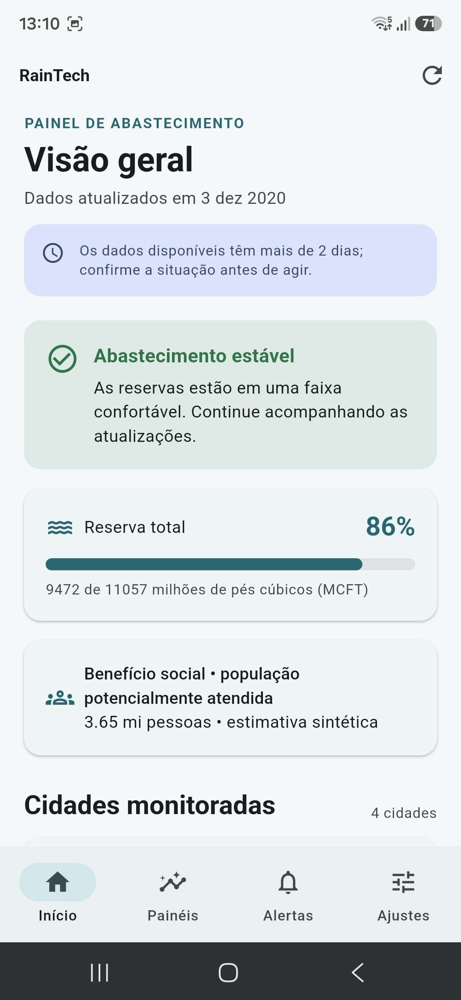
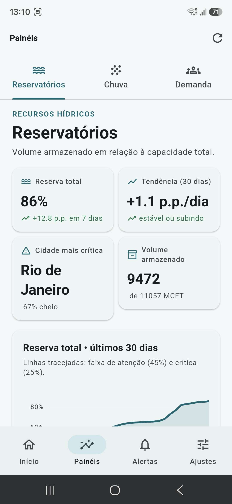
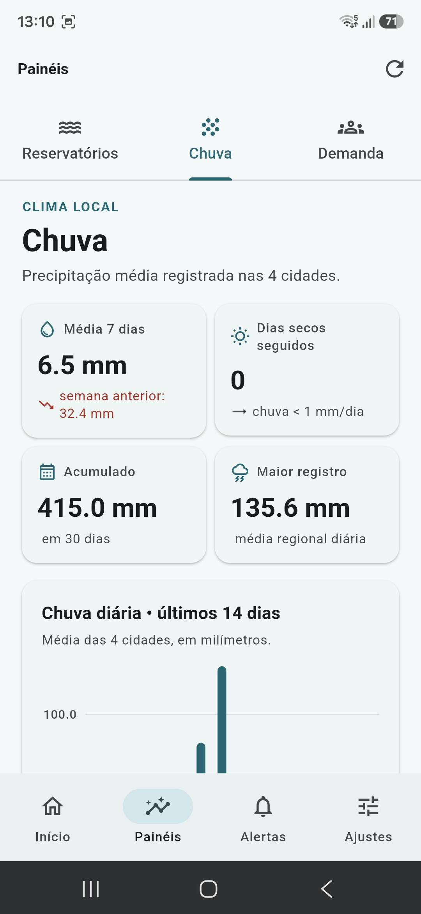
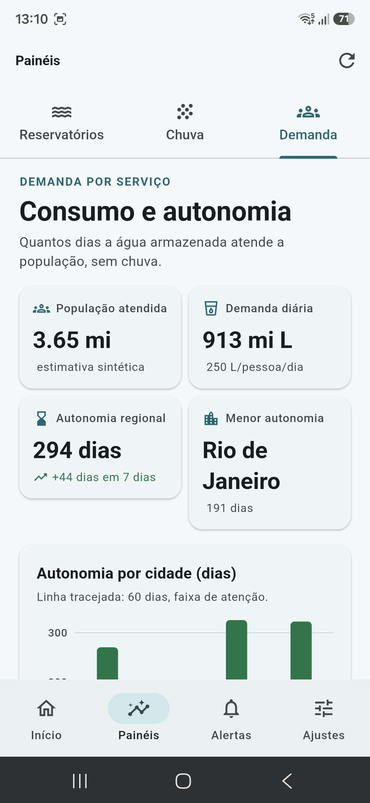
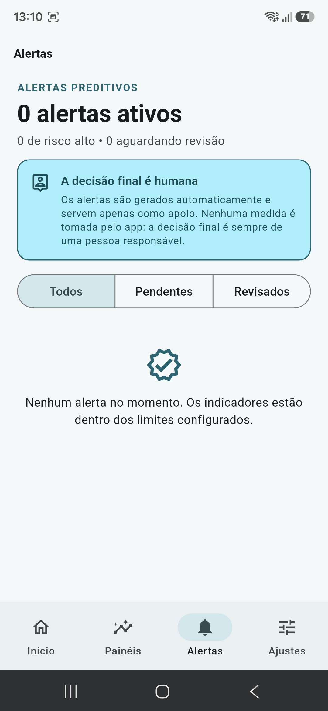
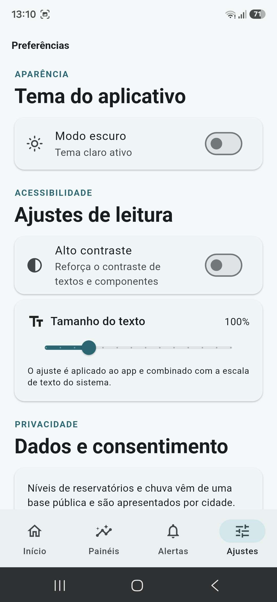

# RainTech

<p align="center">
  
</p>

Aplicativo Flutter para acompanhar níveis de reservatórios, chuva e indicadores
de abastecimento, com painéis por cidade, alertas explicáveis e revisão humana.

## Problema e público-alvo

Dados de reservatórios e precipitação podem ser difíceis de acompanhar em
conjunto. O RainTech reúne essas informações e destaca sinais de atenção, como
queda nos níveis armazenados e períodos com pouca chuva, para apoiar o
planejamento hídrico.

O público principal são equipes técnicas de operadoras de abastecimento e
gestores públicos. Pesquisadores, estudantes e cidadãos interessados em
recursos hídricos também podem consultar os indicadores. O impacto social
esperado é facilitar a identificação antecipada de riscos e apoiar decisões de
abastecimento mais informadas; o aplicativo não substitui a avaliação dos
responsáveis.

## Integrantes

| Integrante | RM | Responsabilidades |
| --- | --- | --- |
| Thiago Sobral de Alvarenga | 562695 | Estrutura inicial, telas de início, preferências e precipitação; acessibilidade, privacidade e indicador social; permissão de internet para a build Android. |
| Diego Antonio Silva Mendes | 565509 | Tema e widgets reutilizáveis; estado compartilhado, rotas e cache offline; painéis de reservatórios, chuva e demanda; alertas e revisão humana. |

## Demonstração visual

<table>
  <tr>
    <td align="center"><strong>Início</strong><br></td>
    <td align="center"><strong>Reservatórios</strong><br></td>
    <td align="center"><strong>Chuva</strong><br></td>
  </tr>
  <tr>
    <td align="center"><strong>Demanda</strong><br></td>
    <td align="center"><strong>Alertas</strong><br></td>
    <td align="center"><strong>Preferências</strong><br></td>
  </tr>
</table>

## Funcionalidades

- [x] Resumo dos dados hídricos na tela inicial.
- [x] Painéis de reservatórios, precipitação e demanda.
- [x] Indicadores e gráficos para comparar os dados disponíveis.
- [x] Geração de alertas com evidências, nível de confiança e limitações.
- [x] Revisão humana dos alertas.
- [x] Cache local do último snapshot para consulta quando a conexão falha.
- [x] Preferências de tema, alto contraste e tamanho do texto.
- [x] Consentimento explícito antes de salvar justificativas de avaliações de
  alertas no aparelho.
- [x] Indicador de benefício social estimado na tela inicial; é uma estimativa
  sintética, não uma medição de impacto real.

## Dados e alertas

O aplicativo consulta uma base pública de dados hídricos disponibilizada ao
RainTech pelo Supabase. O repositório lê as tabelas `reservoir_levels` e
`rainfall`, com a coluna `Date` e as colunas de leitura `POONDI`,
`CHOLAVARAM`, `REDHILLS` e `CHEMBARAMBAKKAM`, até 30 registros recentes.

| Alerta/indicador | Regra usada |
| --- | --- |
| Nível do reservatório | Atenção abaixo de 45%; crítico abaixo de 25%. |
| Projeção de nível | Regressão linear sobre até 14 registros recentes, com horizonte de até 60 dias. A projeção é sinalizada como pouco confiável com menos de 7 registros ou `R² < 0,5`. |
| Autonomia | Estimativa baseada em consumo de referência de 250 L por pessoa/dia; atenção abaixo de 60 dias e risco alto abaixo de 30 dias. |
| Estiagem | Média inferior a 1 mm de chuva por dia durante pelo menos 5 dias consecutivos. |

**Limitações e confiabilidade:** a projeção extrapola tendências históricas e
não prevê chuva futura, evaporação, transferências entre reservatórios ou
manobras operacionais. A estimativa de demanda e população atendida é
sintética. Dados antigos, incompletos, em cache ou de demonstração reduzem a
confiabilidade. O conjunto considera apenas os reservatórios e estações
presentes na base, podendo não representar outras áreas ou populações. Por isso,
os alertas são apoio à análise e não devem ser tratados como previsão garantida
ou decisão automática.

Sem as duas configurações do Supabase, o aplicativo usa dados sintéticos de
demonstração. A população atendida e as estimativas em `DemandModel` também
são sintéticas e não devem ser interpretadas como impacto social medido.

## Privacidade e inclusão

- Os níveis de reservatórios e as medições de chuva vêm de uma base pública.
- O último snapshot e as preferências visuais são armazenados localmente para
  permitir consulta offline.
- Justificativas de texto livre nas avaliações podem conter dados pessoais.
  Elas só são persistidas no aparelho após consentimento explícito; revogar o
  consentimento remove essas avaliações locais.
- O aplicativo oferece alto contraste e ajuste do tamanho do texto, além de
  rótulos semânticos em controles e informações relevantes para leitores de
  tela.

## Tecnologias e decisões técnicas

| Tecnologia/decisão | Justificativa |
| --- | --- |
| Flutter e Material 3 | Interface multiplataforma com componentes consistentes. |
| Provider com `ChangeNotifier` | Compartilha estados reativos sem uma camada de gerenciamento mais complexa que a necessária. |
| Supabase | Acesso à base pública configurada para o projeto. |
| `SharedPreferences` | Armazena o snapshot pequeno, as preferências e as avaliações locais consentidas. |
| `fl_chart` | Exibe séries e comparações nos painéis. |
| Regras determinísticas para alertas | Mantêm limiares e evidências inspecionáveis e deixam a decisão final com uma pessoa. |

A estrutura separa apresentação, estado, dados e análises. Telas e widgets não
acessam diretamente o Supabase nem a persistência local:

```text
lib/
├── main.dart                 # Inicialização e configuração
├── app.dart                  # Providers, tema e rotas
├── analytics/                # Indicadores e regras de alertas
├── core/                     # Rotas e tema
├── data/                     # Repositório e armazenamento local
├── models/                   # Modelos de domínio e serialização
├── screens/                  # Páginas e composição das telas
├── state/                    # Estado compartilhado e fluxos
└── widgets/                  # Componentes reutilizáveis e gráficos
test/
└── widget_test.dart          # Testes de interface e fluxos principais
```

`WaterDataState` coordena carregamento e cache; `AlertsState` recalcula alertas
e gerencia revisões; `SettingsState` mantém preferências. `WaterRepository`
consulta e converte dados, enquanto `AppStorage` cuida da persistência local.
`AlertEngine` aplica as regras e apresenta evidências, confiança e limitações.

## Como executar

É necessário ter Flutter instalado. Para executar em modo de demonstração:

```powershell
git clone https://github.com/thiago-alvarenga07/RainTech.git
Set-Location RainTech
flutter pub get
flutter run
```

Para consultar a base pelo Supabase, configure a URL e a chave `anon` do
projeto antes de executar:

```powershell
$env:SUPABASE_URL = "https://seu-projeto.supabase.co"
$env:SUPABASE_ANON_KEY = "sua-chave-anon"
flutter run --dart-define="SUPABASE_URL=$env:SUPABASE_URL" --dart-define="SUPABASE_ANON_KEY=$env:SUPABASE_ANON_KEY"
```

As tabelas precisam permitir a leitura necessária pela chave pública. Não use
uma chave `service_role` no aplicativo. Uma build Android para instalação está
disponível na seção [Releases](https://github.com/thiago-alvarenga07/RainTech/releases).

## Vídeo

https://youtu.be/TAV1ZqOC6Mw?si=z37dsqlZTcUhgD9k 

## Licença

Projeto acadêmico FIAP — Global Solution 2026.2.
